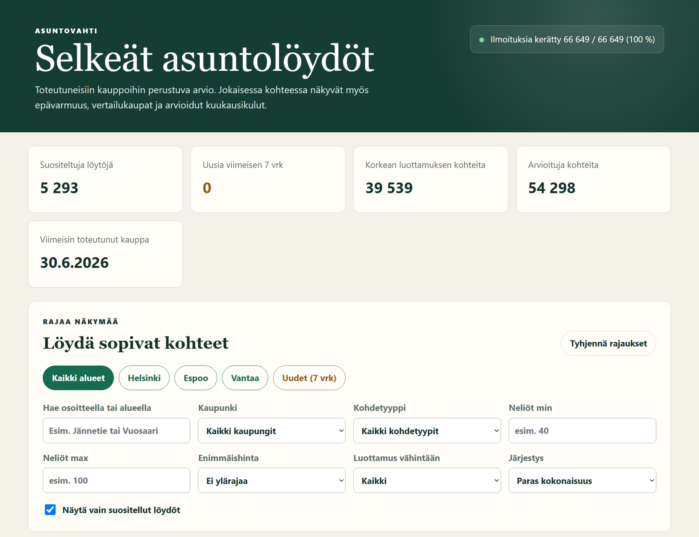
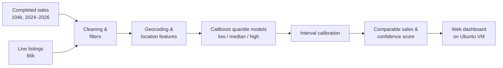
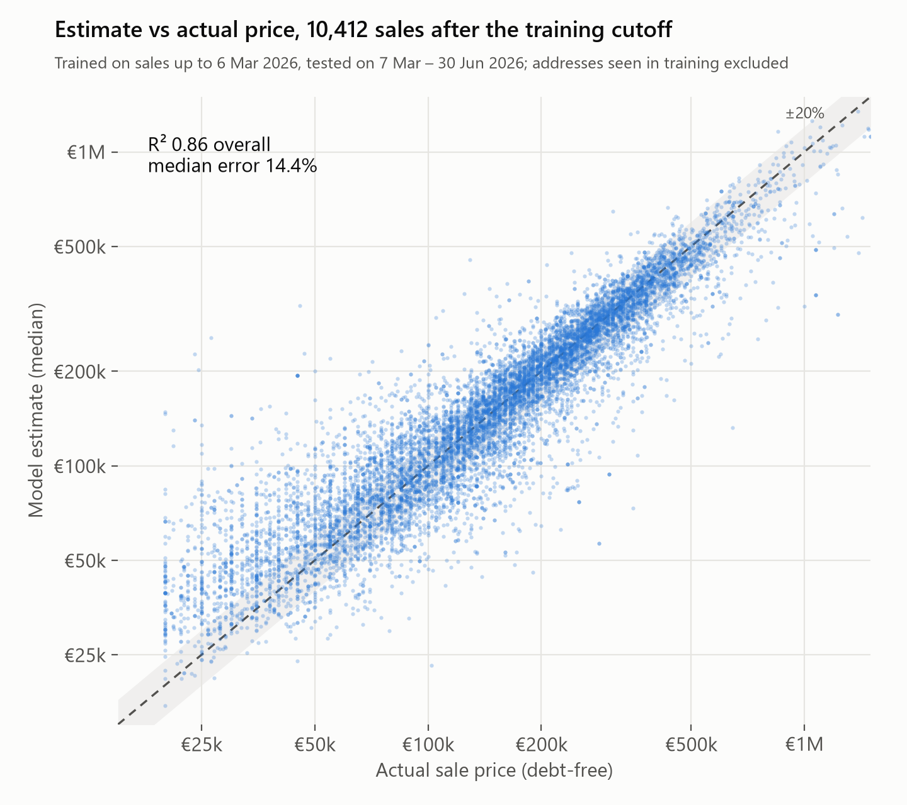
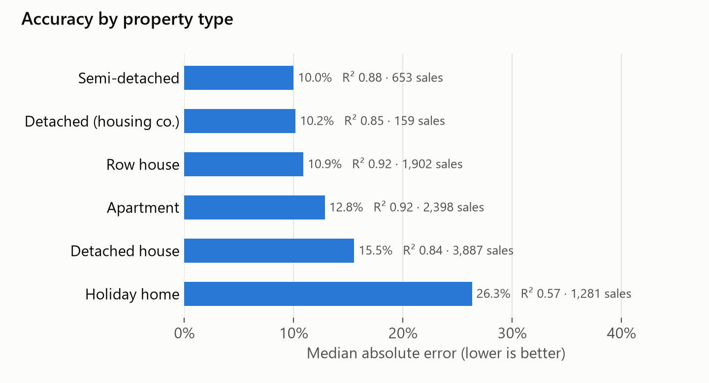

# Asuntovahti: Finnish housing price estimation

Asuntovahti ("housing watch") estimates what a Finnish home is actually worth, based on what similar
homes really sold for, not on asking prices. For every listing on the market it shows a price range,
the comparable sales behind it, how confident the model is and why, and what the home would cost per month.

> **This repository is a showcase.** The source code and data are private because the data comes from
> third-party sources. Happy to walk through the code in an interview; reach me on
> [LinkedIn](https://www.linkedin.com/in/mac-teppo).

The dashboard (UI in Finnish): summary of the current market scan and filters by city, property type, size,
price and confidence.

## What it does

- **Price range, not just a number.** Three CatBoost quantile models give a low, expected and high
  value for each home, calibrated on held-out sales so the range means what it says.
- **Comparable sales.** Up to 12 similar completed sales nearby, so every estimate can be checked by hand.
- **Confidence score with reasons.** Each estimate gets a 0–100 confidence score and plain-language
  warnings instead of false precision, e.g. few comparable sales nearby, the model and the comparables
  disagree, size outside the training range, a large housing-company loan share or an upcoming pipe renovation.
- **Safety margin.** A conservative value compared with the asking price, so only clear bargains get flagged.
- **Monthly cost.** An editable loan and running-cost calculator for each home.
- **Honest validation.** Accuracy is measured on sales that happened after the training data ends (see below).

## How it works

- **Data:** 104,430 completed sales from November 2024 to June 2026 across 375 municipalities, plus
  about 66,000 live listings to price.
- **Features (~60):** size, rooms, building year, floor and elevator, plot ownership and ground rent,
  debt share, condition, energy class, heating and building material, sauna, balcony and shoreline.
  Pipe and roof renovations (done or upcoming) are parsed from the listing text. Location comes from
  geocoded coordinates, postcode and distances to major Finnish cities.
- **Models:** CatBoost regressors with quantile loss at the 15th, 50th and 85th percentiles. Interval
  factors are calibrated on held-out data, which lifts interval coverage from 62% to 80%.
- **Serving:** a lightweight Python server and a vanilla-JS dashboard, deployed as a systemd service on an
  Ubuntu cloud VM. Includes a pytest suite for the feature parsing, filters, valuation and server.

## Validation

The model is trained on sales up to **6 March 2026** and tested on the **10,412 sales from 7 March to
30 June 2026**, excluding addresses it saw in training. That mirrors real use: pricing homes the model
has never seen, in a market that has moved on since training.

| Segment | Test sales | R² | Median error |
|---|---:|---:|---:|
| **All homes** | 10,412 | 0.86 | 14.4% |
| Apartments | 2,398 | **0.92** | 12.8% |
| Row houses | 1,902 | **0.92** | 10.9% |
| Helsinki | 791 | 0.90 | 9.9% |
| Vantaa | 297 | 0.89 | 8.9% |
| Espoo | 416 | 0.88 | 10.4% |
| Tampere | 395 | 0.84 | 10.4% |
| Holiday homes | 1,281 | 0.57 | 26.3% |

Holiday homes are the hardest segment, likely because comparable sales are sparse and their prices depend on
things listings rarely describe well, such as shoreline quality and road access.

## Limitations

An estimate is not a substitute for a condition inspection, the housing company's financial statements or a
professional valuation. The tool is built to find homes worth a closer look, not to make the decision.

## Tech

Python · pandas · CatBoost · scikit-learn · SHAP · geospatial feature engineering · JavaScript · Linux / systemd

---

Built by **Mac Teppo**, M.Sc. student in Machine Learning, Data Science and AI at Aalto University.
